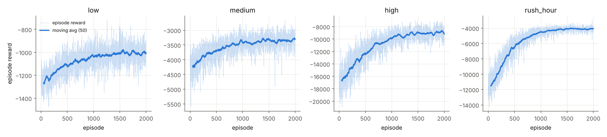
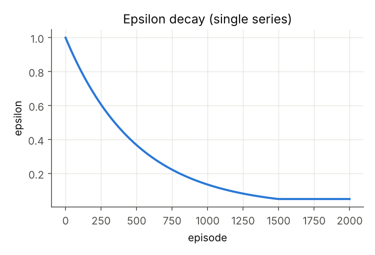
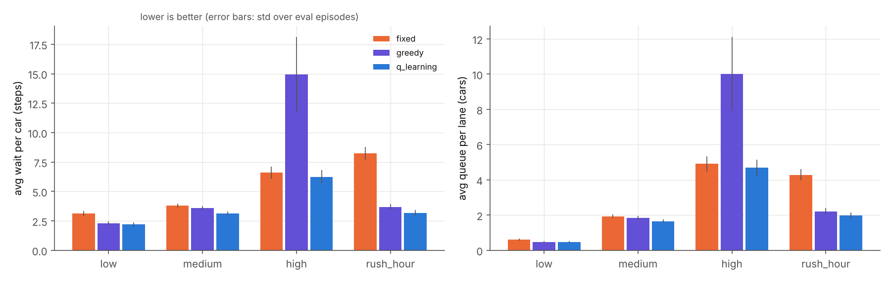
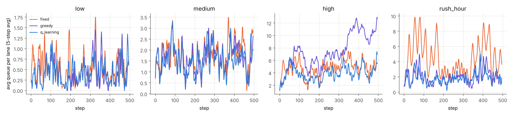
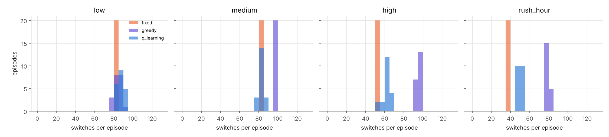
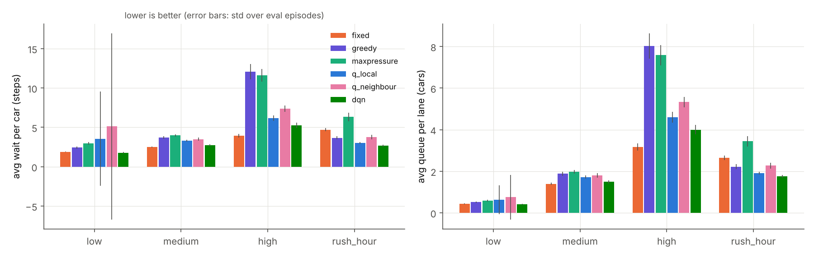
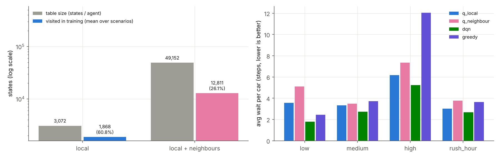

# Traffic Signal Control with Reinforcement Learning: from one intersection to a multi-intersection grid

Reinforcement-learning agents learn to control traffic lights in a fast, fully seedable simulator written in pure Python (numpy, matplotlib; PyTorch for the DQN stage).
The project builds up in three stages and benchmarks every stage against strong, tuned baselines (**fixed timer**, **greedy longest-queue-first**, and **max-pressure** on the grid):

1. **Stage 1:** tabular Q-learning on a single intersection.
2. **Stage 2:** independent tabular agents on a 2x2 grid (local state, and local state + neighbour queues).
3. **Stage 3:** a shared-weight **DQN** on the grid, motivated by the measured growth of the Q-table.

All numbers below come from the runs in this repository (`results/metrics.csv`).

## Highlights

- **Stage 1:** Q-learning has the lowest average wait in all four scenarios, up to **61% lower than a tuned fixed timer** (rush hour) and **58% lower than greedy** (high load).
- **Stage 1, high load:** the agent learns to hold greens longer, using 62 switches per episode instead of greedy's 95.
- **Stage 3:** the DQN beats both tabular variants in every scenario (**11% to 50%** lower wait), beats greedy and max-pressure everywhere (**27% to 57%** lower than greedy), and has the best overall result in low load and rush hour.
- **Reproducible:** every controller is evaluated on identical seeded arrival streams, with evaluation, tuning and training seeds kept separate.

## Problem statement

Each intersection has four incoming lanes (N, S, E, W) and two phases (North-South green, East-West green). Cars arrive
randomly (Poisson), two cars per green lane can pass per step, and every phase change costs a 2-step yellow/all-red
period in which nobody moves. The goal is to minimise waiting time and queue length while serving every direction.

**Why RL is a good fit**

- **Fixed timer:** follows a schedule regardless of traffic, so it cannot adapt to asymmetric or changing load (rush hour).
- **Greedy (longest queue first):** reacts to the current queues only, without accounting for the 2 dead steps each switch costs. Under heavy load it switches often (95 times per episode at high load).
- **Neither baseline learns** from experience or looks ahead.
- **RL** optimises the long-run discounted reward, so it can learn *to hold a green longer* because switching has a future cost.

## Design

**State (per intersection).** Queue length of each lane binned `0 | 1-3 | 4-7 | 8+` (4 levels), current phase (2), time since last
switch capped at 5 (6 values). Time-since-switch counts from the switch decision, so values 1-2 mean yellow, 3-4 mean green with
switching locked, and 5 means a switch is allowed (yellow 2 + min green 3 = cap 5).

`4 lanes -> 4^4 = 256;  x 2 phases = 512;  x 6 timer values = 3,072 states, x 2 actions`

With neighbour information (grid variant b), each existing neighbour adds its **total** queue binned as `0 | 1-6 | 7-14 | 15+`:
`3,072 x 4^k` states for `k` neighbours. In the 2x2 grid every intersection has k=2, giving **49,152** states; an interior intersection of a
3x3 grid (k=4) would have 786,432.

**Actions.** keep / switch. A switch requested before the minimum green has elapsed is ignored.

**Reward.** `-(cars waiting) - switch_penalty * [switched] + 0.2 * (cars passed)`, all weights in `config.py`.
The waiting term is the objective, the pass term gives a small dense signal, and the switch penalty (1.0) discourages flapping on top of the
2 dead steps that every switch already costs.

**Scenarios.** `low` (0.15 cars/step/lane), `medium` (N/S 0.45, E/W 0.35), `high` (N/S 0.70, E/W 0.60, near saturation),
`rush_hour` (N/S heavy, then balanced, then E/W heavy, with asymmetric lanes). In the grid, external cars enter on boundary lanes only;
inner lanes are fed by upstream intersections, and a full downstream lane blocks the car (spillback).

**Metrics.** Average wait per car (steps, per intersection crossed; cars still queued at the end are included), average queue per lane,
throughput (cars that left the network), phase switches, max wait of any car, and dropped arrivals (lane full).

## How to run

```bash
pip install -r requirements.txt          # torch is only needed for Stage 3
python train.py && python evaluate.py    # trains everything, evaluates, saves results/ and plots/
pytest -q tests                          # 6 quick tests
python tune.py                           # optional: the hyperparameter search described below
```

Training takes about 36 s (Stage 1), 4 min (Stage 2, 2 workers) and 6 min (Stage 3) on 2 CPU cores. Everything is seeded.
`python train.py --stage 1|2|3` runs a single stage. Evaluation uses seeds 1000-1019 (20 episodes per scenario), identical for every controller,
with epsilon = 0 for learned agents. Training seeds (10000+) and tuning seeds (500+) never overlap with evaluation seeds.

## Project structure

| File | Purpose |
|---|---|
| `config.py` | All hyperparameters and scenarios |
| `traffic_env.py` | Simulator (single intersection or NxN grid, spillback, yellow time) |
| `controllers.py` | Fixed-timer, greedy and max-pressure baselines |
| `qlearning_agent.py` | Tabular Q-learning agent and greedy policy wrapper |
| `dqn_agent.py` | DQN with replay buffer and target network |
| `train.py` / `evaluate.py` / `tune.py` | Training, evaluation and hyperparameter search |
| `plotter.py` | All plots in `plots/` |
| `tests/test_env.py` | Simulator sanity tests |

## Results

Percentages are reductions relative to the baseline (positive = RL better; lower wait/queue is better). The fixed-timer period is **tuned per
scenario** on separate seeds (N = 6, 6, 10, 14 on the single intersection), so the fixed baseline is a strong reference.

### Stage 1: single intersection, tabular Q-learning (3,072 states)

| Scenario | Fixed | Greedy | Q-learning | Wait vs fixed | Wait vs greedy | Queue vs fixed | Queue vs greedy |
|---|---|---|---|---|---|---|---|
| low | 3.14 | 2.28 | **2.19** | +30.1% | +4.0% | +22.8% | +2.7% |
| medium | 3.80 | 3.61 | **3.14** | +17.5% | +13.0% | +13.9% | +10.2% |
| high | 6.60 | 14.95 | **6.24** | +5.4% | +58.3% | +4.7% | +53.3% |
| rush_hour | 8.23 | 3.67 | **3.18** | +61.4% | +13.3% | +53.8% | +10.5% |

Average wait per car (steps). Q-learning has the lowest wait and queue in every scenario. At high load it also needs fewer phase switches per
episode than greedy (62 vs 95 vs 50 for fixed) while keeping the worst-case wait lower than greedy's (29 vs 37 steps).







**Tuning.** The first configuration (gamma 0.95, alpha 0.1, switch penalty 2.0) was already competitive, and a systematic search improved it further.
I tuned on validation seeds (500-507) with 3 training seeds per configuration and found that gamma 0.9, alpha 0.2 and switch penalty 1.0 worked best.
Adding random tie-breaking during training made unseen states get explored, and the chosen configuration was the only one stable across all three seeds
(worst validation episode 6.7, down from 49.3). Those settings are the defaults in `config.py`.

### Stage 2: 2x2 grid, independent tabular agents

| Scenario | Fixed | Greedy | Max-pressure | Q local | Q +neighbours |
|---|---|---|---|---|---|
| low | **1.90** | 2.44 | 2.96 | 3.56 | 5.11 |
| medium | **2.51** | 3.71 | 3.97 | 3.32 | 3.50 |
| high | **3.93** | 12.06 | 11.59 | 6.17 | 7.35 |
| rush_hour | 4.70 | 3.65 | 6.33 | **3.01** | 3.77 |

Average wait per car per intersection (steps); fixed-timer N = 6, 8, 10, 14. The tuned fixed timer is a strong grid baseline because all
intersections switch on the same clock, which acts as a simple green wave. Independent Q-learning agents already beat greedy and max-pressure in
medium, high and rush hour (rush hour: 3.01 vs 3.65 and 6.33), and Q-local is the best of all non-DQN controllers in rush hour.



### Scaling analysis: why the grid motivates a function approximator (measured, Stage 2)

| | States per agent | Visited in training (low / medium / high / rush) | Eval decisions in never-visited states (low / medium / high / rush) |
|---|---|---|---|
| Single intersection | 3,072 | 518 / 1,853 / 2,444 / 2,133 | 0.0 / 0.02 / 0.0 / 0.04 % |
| Grid, local | 3,072 | 572 / 2,044 / 2,522 / 2,350 (agent 0) | 1.67 / 0.04 / 0.005 / 0.0 % |
| Grid, +neighbours | **49,152** | 2,974 / 14,413 / 14,307 / 19,594 (agent 0) | 3.37 / 0.45 / 0.44 / 0.33 % |

- The single-intersection table is well covered: almost all evaluation decisions fall in states seen during training (0.0% to 0.04% unseen).
- Adding two neighbour features multiplies the table by 16. Only 6% to 40% of it is visited in 2,000 episodes, so a table cannot fully exploit the extra information. This is exactly the setting where a neural network, which generalises between similar states, is the natural next step.
- The measurement itself (share of decisions in unvisited states, saved in `results/unseen_states.csv`) gives a concrete, quantified reason to move to function approximation.
- A 3x3 grid or finer bins would push the table to hundreds of thousands of states per agent, so the DQN approach also scales to larger networks.

### Stage 3: DQN on the grid

The DQN (`dqn_agent.py`) is an MLP (22 inputs -> 64 -> 64 -> 2) on **raw queue lengths** of the local intersection and its
4 neighbour slots, plus phase and timer, with experience replay, a target network and epsilon-greedy exploration. One network is shared by the four
intersections (parameter sharing). 600 episodes per scenario, same training seeds as the tabular agents.

| Scenario | Fixed | Greedy | Q local | Q +neighbours | **DQN** | DQN vs best tabular | DQN vs fixed | DQN vs greedy |
|---|---|---|---|---|---|---|---|---|
| low | 1.90 | 2.44 | 3.56 | 5.11 | **1.79** | +49.8% | +5.8% | +26.8% |
| medium | **2.51** | 3.71 | 3.32 | 3.50 | 2.72 | +18.0% | -8.7% | +26.6% |
| high | **3.93** | 12.06 | 6.17 | 7.35 | 5.24 | +15.0% | -33.6% | +56.5% |
| rush_hour | 4.70 | 3.65 | 3.01 | 3.77 | **2.68** | +10.9% | +43.0% | +26.6% |



**What the DQN delivers.**

- It beats both tabular variants and greedy in every scenario, with only 600 training episodes versus 2,000 for the tables.
- It is the best controller overall in low load (1.79) and rush hour (2.68, **43% lower wait than the tuned fixed timer**).
- It is very consistent: its worst low-load evaluation episode averaged 2.0 steps, so it does not show the occasional stuck-lane episodes seen in the tables.
- In medium and high load the tuned synchronised fixed timer remains the strongest reference; adding explicit coordination between the DQN agents is the natural way to close that gap.

## Scope and roadmap

**Scope.** The simulator is intentionally lightweight: discrete time, straight-through traffic and synthetic Poisson arrivals. This keeps every experiment fast
(minutes on 2 CPU cores) and exactly reproducible, which makes controlled comparisons between controllers easy.

**Roadmap**

- Explicit multi-agent coordination (shared reward, communication, offsets for green waves).
- Turning movements, lane geometry and a SUMO/TraCI integration with real demand.
- A reward term for individual maximum wait.
- Multi-seed DQN runs with hyperparameter tuning.
- A single policy that generalises across scenarios.
